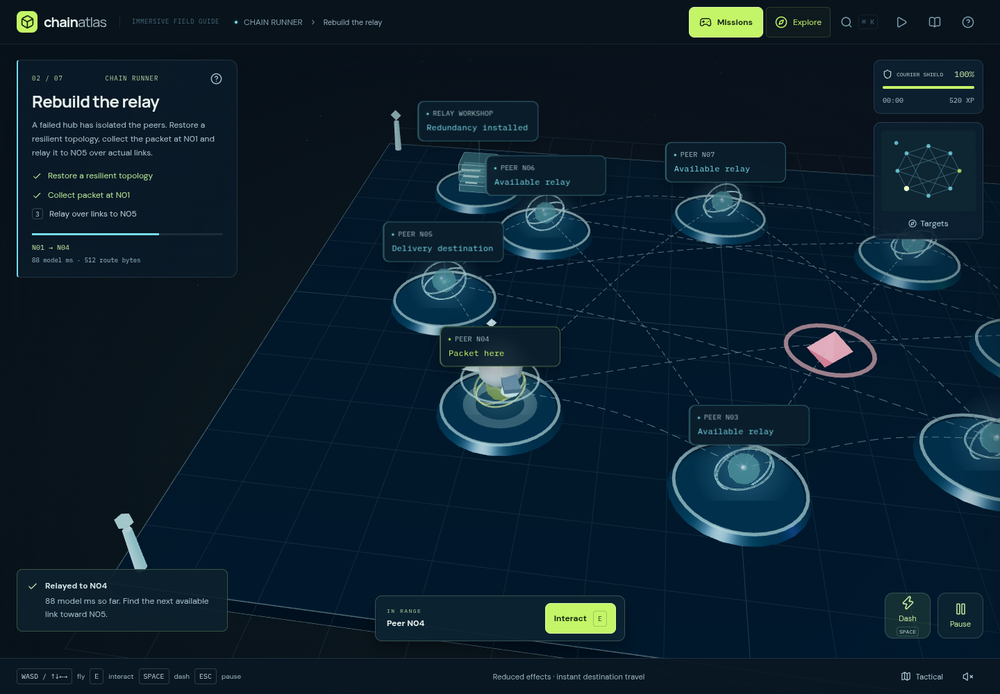
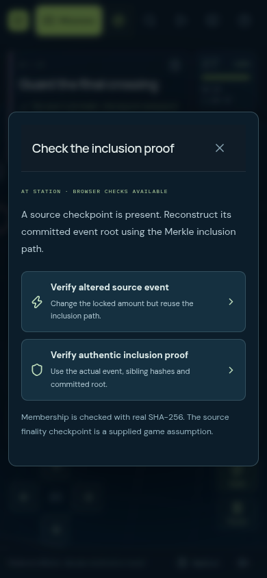
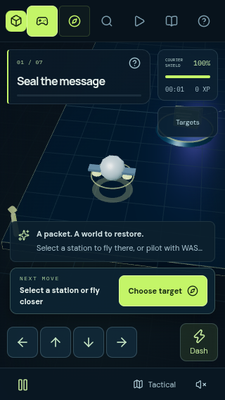

# Chain Runner

[Play the expedition](https://sloth-os.github.io/Blockchain/?play=1), or select **Play** in the atlas header.

Chain Runner makes blockchain requirements into a seven-mission 3D courier game. Players collect data, follow real graph edges, check commitments and carry acknowledgments across institutional boundaries. Every mission uses the atlas's existing scene and renderer. Returning to the field guide retains the current attempt; there are no standalone lab pages or extra WebGL contexts.

## Campaign and learning goals

| Mission                       | What the player does                                                                                                            | Rule that the game enforces                                                                                                                                                                   |
| ----------------------------- | ------------------------------------------------------------------------------------------------------------------------------- | --------------------------------------------------------------------------------------------------------------------------------------------------------------------------------------------- |
| **Seal the message**          | Recover a payload and visit the signing terminal. Try the original or an altered amount.                                        | The original message must pass the existing browser Ed25519 verification. A changed amount fails.                                                                                             |
| **Rebuild the relay**         | Choose a resilient topology, collect the message at N01, relay to N05.                                                          | Every healthy peer must remain reachable after a failure, with healthy and failure p95 under 300 model ms. Only the mesh meets both requirements. Physical flight cannot create a graph edge. |
| **Forge a commitment**        | Collect four hash shards and take them to the forge.                                                                            | The browser recomputes the actual four-leaf teaching Merkle root and compares it with the current atlas commitment.                                                                           |
| **Earn the quorum**           | Gather signed votes for a block and open its checkpoint.                                                                        | The 34%, 26% and 22% votes contribute 82%. A valid signature on another block contributes zero. Repeated visits cannot count a vote twice.                                                    |
| **Find the scaling route**    | Choose among six gateways for 500 contract calls/s, 512-byte payloads, Ethereum settlement, published data and validity proofs. | The ZK route meets this teaching scenario. A high-capacity independent base layer still fails the requested settlement rule.                                                                  |
| **Cross into the real world** | Carry a fictional USDC burn receipt through issuer authorization, a bank handoff and customer delivery.                         | An on-chain burn alone cannot confirm a bank payment. The fictional holder must be eligible for the issuer's redemption process.                                                              |
| **Guard the final crossing**  | Collect a source event, checkpoint and inclusion path; check the genuine or altered event; open the destination gate.           | Actual SHA-256 reconstruction must match the committed root. Inclusion and the supplied source-finality assumption are separate conditions. The untrusted shortcut fails.                     |

Each mission links to the existing primary-source library: [Ethereum transactions](https://ethereum.org/en/developers/docs/transactions/), [networking](https://ethereum.org/en/developers/docs/networking-layer/), the [Bitcoin paper](https://bitcoin.org/bitcoin.pdf), [proof of stake](https://ethereum.org/en/developers/docs/consensus-mechanisms/pos/), [ZK rollups](https://ethereum.org/en/developers/docs/scaling/zk-rollups/), [Circle's USDC reserve disclosures](https://www.circle.com/transparency), and [bridge assumptions](https://ethereum.org/en/developers/docs/bridges/). These sources ground the lessons; they do not describe the fictional flight mechanics or resource budgets.

## Controls and feedback

| Control                     | Action                                                                      |
| --------------------------- | --------------------------------------------------------------------------- |
| WASD / arrow keys           | Fly relative to the camera. Diagonal movement is normalized.                |
| E                           | Interact with a station within range.                                       |
| Space / Dash                | A short burst with protection through interference, followed by a recharge. |
| Station label / Targets     | Travel to a station and interact after arrival.                             |
| Tap the floor               | Fly to a point in the arena.                                                |
| Drag / pinch / + / − / Home | Orbit, zoom and reset the camera. Keyboard zoom requires canvas focus.      |
| Tactical / Follow           | Switch between an overview and the courier camera.                          |
| Escape / Pause              | Pause an attempt, or close its current dialog.                              |

The courier has 100 shield. Interference collisions cost 18; rejected protocol choices cost 12. A depleted shield offers a retry of the current mission. Previously completed missions remain available. Insufficient prerequisites, such as reaching the forge too early, explain the missing step without damage.

The HUD includes objectives, a minimap, reachable targets, shield, an active-time clock, progress and action feedback. Orbiting cargo depicts recovered data. Scanner pulses show action outcomes. In-world rings show four-leaf collection and valid stake, including the two-thirds checkpoint marker. The relay mission displays its actual route, payload bytes and accumulated model latency.

Three stars require no mistakes; two permit up to two mistakes. Time is recorded without a deadline or time bonus. Score is `max(100, 300 + 2 × remaining shield + 20 × unique inventory items − 15 × mistakes)`. Rejecting a vote for another commitment is a successful verification outcome and does not spend shield.

## Access and persistence

The game supports keyboard, pointer and touch controls. Native dialogs provide focus containment and Escape handling. A target list reaches every station, including stations outside the current camera frame. Labels avoid actual HUD bounds. Short phone screens use a single row of flight arrows; landscape keeps the target-list button available. Primary flight and action buttons retain 44 px minimum targets.

Reduced effects stop decorative motion and hazard movement; choosing a destination travels instantly. Manual flight remains available. The global setting persists with the atlas motion preference. Without WebGL, station and route-list interactions remain playable with local cryptography. If browser cryptography itself fails, the game explicitly labels its checks as illustrated and discloses that verification did not run.

Best XP, best star count and fastest recorded active time are stored independently in `chain-atlas:runner:v1` in local storage. Refreshing resumes at the first incomplete mission's start. Returning to the atlas and reopening the game preserves an in-memory attempt, including cargo and courier position. Local-storage failure keeps records in the current session and changes the progress notice. No wallet, account, analytics service, multiplayer server or financial transaction is involved.

## Model boundaries

- Each attempt keeps its signed message, Merkle tree and block commitment. Editing an atlas draft applies to the next mission or retry. Resumed attempts cannot combine votes from different drafts.
- Signatures and SHA-256 checks run locally with ephemeral keys. The JSON message and ATLAS asset are fictional. These are not Bitcoin or Ethereum transaction encodings.
- Merkle parents hash concatenated hexadecimal strings, as in the existing teaching model. Bridge inclusion follows the first leaf of a four-event tree. It is not a production bridge implementation.
- The quorum is a weighted signature puzzle over one commitment. It does not implement Ethereum epochs, fork choice, slashing, adversarial networking or consensus safety.
- The bridge checkpoint is supplied by the scenario. The game verifies membership, not foreign-chain finality. A membership proof cannot establish finality or prevent all bridge failures.
- Network latency uses the existing deterministic first-arrival model: link latency, deterministic jitter and payload serialization. The hub scenario removes the hub first; mesh and ring remove the last peer. The failure-policy difference is disclosed in the topology choice. Congestion, retransmission, transport overhead and packet loss are omitted.
- Courier flight time, model network milliseconds and chain settlement time are different quantities. The flight clock advances with active simulation frames, clamps long frame gaps and pauses with dialogs/backgrounding. It is not a network measurement or competitive wall-clock leaderboard.
- Six scaling gateways use the atlas's fixed illustrative resource budgets. The mission's ZK answer follows its explicit requirements; it does not claim one solution is universally fastest or best.
- USDC redemption is a fictional eligible-holder scenario. It does not imply that all token holders can redeem directly or that a ledger transfer delivers bank funds.

## Implementation and verification

`src/game/model.ts` contains mission rules, objectives, scoring, persistence validation and bounded movement. `crypto.ts` performs real vote and inclusion checks. `useChainGame.ts` coordinates the atlas, asynchronous verification, progress and pause states. `runtime.ts` supplies the courier, hazards, cargo, gauges, navigation and collision handling inside `Scene.tsx`. `spatial.ts` adds semantic stations and pathways to the existing atlas. `GameHUD.tsx` supplies accessible controls and dialogs.

The unit suite covers protocol prerequisites, graph edges, root checks, duplicate votes, divergent commitments, proof tampering, bounded movement, collision depletion, save validation and unlocked checkpoints. Browser tests complete all seven missions, make wrong choices and recover, retain the original WebGL context, exercise normal flight/dash/E interaction, pause/resume, touch controls, compact dialogs, checkpoint retry, sound, reload, missing WebGL and unsupported cryptography. Existing atlas tests remain part of the same publication workflow.

Run the visual campaign against a running development or production server:

```sh
npm run build
npm run preview -- --port 4174
# In a second terminal:
REVIEW_BASE_URL=http://127.0.0.1:4174 \
PLAYWRIGHT_CHROMIUM_EXECUTABLE_PATH=/usr/bin/chromium npm run review:game
```

The script plays the entire campaign and captures desktop, phone and landscape states, plus a compact phone. It writes a browsable gallery and layout metrics under `artifacts/game-review/latest/`. Browser captures are reviewed visually; they are not pixel-diff assertions. Tests use Chromium with SwiftShader in cloud environments. Physical mobile hardware and other browser engines require separate testing.

## Visual review findings

The campaign review covers **49 captured states** at 1440 × 1000, 390 × 844, 844 × 390 and 320 × 568. The complete regression suite contains **39 unit tests and 25 Chromium browser tests**. The final game-specific checks also exercise the improved target action and all seven mission transitions.

| Finding while playing and reviewing the screens                                              | Implemented change                                                                                                                 |
| -------------------------------------------------------------------------------------------- | ---------------------------------------------------------------------------------------------------------------------------------- |
| Keyboard flight stopped after selecting a HUD button.                                        | Flight keys work while HUD buttons have focus; Space and Enter retain normal button activation.                                    |
| Small screens obscured stations and the courier.                                             | The camera reserves space for controls, short phones use one row of arrows, and station labels avoid measured HUD rectangles.      |
| Landscape hid the minimap and its only visible target-list action.                           | The map contracts to a persistent target button. All stations remain reachable.                                                    |
| A disabled Interact button gave no useful action when far from a station.                    | The primary action offers **Choose target** until a station is in range.                                                           |
| Another header action pushed the narrowest atlas grid beyond the screen.                     | The grid constrains its column and the smallest header removes excess spacing; the original workbench and all landmarks still fit. |
| The fourth Merkle shard still suggested collecting more shards.                              | Completing the collection directs the courier to the forge and explains its full ring.                                             |
| Phone rewards required too much scrolling before the next action.                            | More compact reward spacing keeps the primary action closer to the result.                                                         |
| A mission transition referenced nonexistent signing stations in the unrepaired relay sector. | Unrepaired networks have no relay pathways; a regression test validates every mission's 3D connections.                            |
| A browser lacking cryptography could receive wording claiming actual verification.           | Compatibility outcomes explicitly state that they are illustrated and that verification did not run.                               |

Selected unmodified Chromium screenshots:

| Network mission                                                                         | Mobile proof challenge                                                                  |
| --------------------------------------------------------------------------------------- | --------------------------------------------------------------------------------------- |
|  |  |


