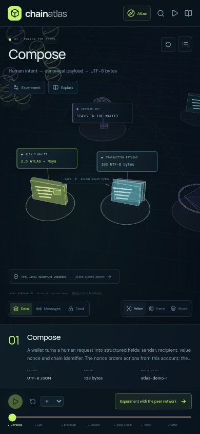
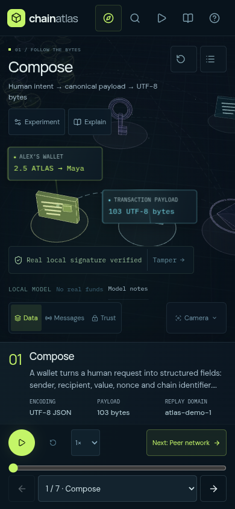
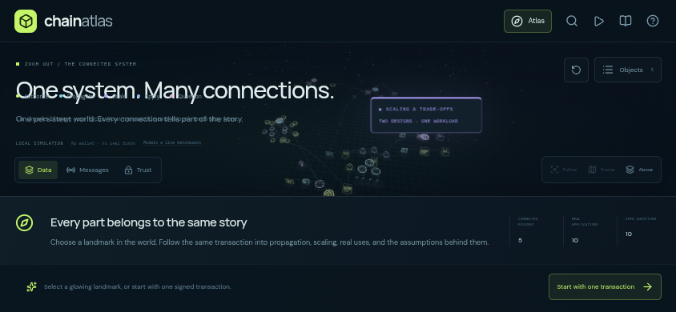
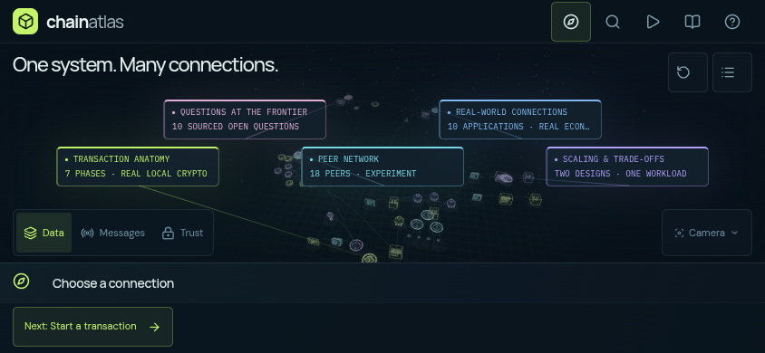

# Browser and visual UX review

Reviewed on **8 November 2026 (America/Los_Angeles)**. The review found and corrected problems in legibility, navigation, playback feedback and experiment integrity while retaining the single immersive world.

The original 11 browser tests passed before this review. Exercising additional combinations and inspecting actual browser screenshots exposed issues those checks did not cover. The updated suite contains **19 browser tests**, alongside **25 unit tests**.

## Findings and changes

| Finding from the user’s perspective                                                                                                 | Change                                                                                                                                                                                                                                                  | Verification                                                                                     |
| ----------------------------------------------------------------------------------------------------------------------------------- | ------------------------------------------------------------------------------------------------------------------------------------------------------------------------------------------------------------------------------------------------------- | ------------------------------------------------------------------------------------------------ |
| An invalid amount, including zero, could still reach “Settle.”                                                                      | Invalid drafts keep the timeline at Compose, block playback and later phases, and explain how to recover. Input validity is announced accessibly.                                                                                                       | Invalid, empty, negative, too-small and excessive amounts, followed by a valid draft.            |
| A broadcast paused at 29 / 1,707 model milliseconds said “Broadcast complete.”                                                      | Running, paused, completed and disconnected delivery have distinct messages. A disconnected graph does not show a healthy p95. Playback speed labels match the selected speed.                                                                          | Real-time pause, stable progress, resume, completion, failure and shared transaction readouts.   |
| Selecting identical comparison designs could leave old throughput columns in an application story.                                  | Readout identity follows its display position, so exactly the current three columns remain.                                                                                                                                                             | Equal A/B designs, design changes and navigation to Chainlink; React key warnings are monitored. |
| Mobile narration was 9 px, object values were 7 px, and several header controls were only 15 px wide.                               | Narration is 13 px on phones and 14 px on desktop. Object values are 12–13 px. Primary touch controls have 44 px targets. Camera choices use a compact menu.                                                                                            | Rendered screenshots, computed dimensions, keyboard and touch-sized viewport checks.             |
| A 320 px phone overflowed horizontally. Landscape exposed only one of five landmarks.                                               | Layout works from 320 px. Compact and short views use readable anchored landmark arrangements; annotation placement accounts for the actual introduction and HUD.                                                                                       | All five landmarks remain reachable on phones, tablets, landscape and a 1280 × 720 desktop.      |
| Seven tiny phase labels were difficult to tap.                                                                                      | Phones and tablets have a labeled phase selector and Previous/Next controls while retaining scrubbing.                                                                                                                                                  | Select and advance phases using native controls.                                                 |
| Opening a workbench did not move keyboard focus to it or reliably return focus after closing. Help was hidden on phones.            | Focus enters the contextual panel, returns to its trigger, and the camera menu supports Escape and focus restoration. Help remains available on small screens. Obscured HUD controls are inert behind the phone sheet.                                  | Keyboard-only workbench, camera menu and help-dialog flows.                                      |
| A larger edited transaction could exceed the minimum message budget shown by the experiments.                                       | Network and scaling use one shared byte-budget state. The minimum rises automatically to cover the current payload, signature and public key.                                                                                                           | Edit a draft after choosing the previous minimum; inspect both experiments.                      |
| The fourth application/issue phase stopped before its animation could run. Pausing there could reset the story.                     | The final phase gets its full playback interval; pausing preserves that phase.                                                                                                                                                                          | Controlled browser time through all four phases and pause/resume interaction.                    |
| On a phone, duplicated narration and introductory text consumed the space needed for controls and the scene.                        | Opening the sheet condenses the introduction and hides duplicate narration. The process controls remain available, with more room for both the experiment and the 3D objects.                                                                           | All five areas with tools open and closed at four responsive sizes.                              |
| Repeated network flow labels and unrelated geometry competed with the current explanation. Trust labels repeated a generic caption. | The focused area gets stronger visual emphasis. Navigation markers appear on the atlas; network annotations prioritize a few paths or the selected peer. Trust labels ask questions appropriate to each object, with full assumptions in its inspector. | Data/Messages/Trust captures and inspection of application, topic and network mechanisms.        |

## Visual evidence

These are unmodified screenshots from Chromium, with reduced motion enabled for a stable visual comparison.

| Phone before                                                                     | Phone after                                                                                       |
| -------------------------------------------------------------------------------- | ------------------------------------------------------------------------------------------------- |
|  |  |

| Landscape before                                                             | Landscape after                                                               |
| ---------------------------------------------------------------------------- | ----------------------------------------------------------------------------- |
|  |  |

## Coverage

The repeatable capture pass produces **144 screenshots and 28 contact sheets**, plus a browsable HTML gallery and a JSON manifest:

- Seven transaction phases.
- Mesh, ring, hub and failed-hub delivery.
- All six comparison designs.
- All ten applications at all four mechanism steps: Bitcoin, USDC, Uniswap, Aave, NFTs, ENS, Chainlink, BUIDL, Helium and WFP Building Blocks.
- All ten issues at all four steps: scaling, stablecoins, tokenization, MEV, bridges, availability, wallets, privacy, post-quantum security and DePIN.
- Data, Messages and Trust lenses.
- All five areas with tools open and closed, plus the atlas, at 320 × 740, 390 × 844, 768 × 1024 and 844 × 390.

Functional checks additionally cover actual browser Ed25519 signing, tamper rejection and recovery, shared settings, search, research and help dialogs, persistent canvas/WebGL context, legacy links, reduced motion, keyboard orbit/zoom, browser-dispatched two-finger pinch, the WebGL-free compatibility view and final-phase playback.

Captures freeze motion for inspection; real-time network playback, canvas gestures and controlled-time mechanism playback are tested separately. Device sizes and touch input are emulated in Chromium. Physical iOS/Safari and other browser engines have not been tested in this review.

## Reproduce

```sh
npm ci
npm run build
npm test
PLAYWRIGHT_CHROMIUM_EXECUTABLE_PATH=/usr/bin/chromium npm run test:e2e
```

For the visual gallery, leave a production preview running in another terminal:

```sh
npm run preview -- --port 4173
```

Then capture the rendered interface:

```sh
PLAYWRIGHT_CHROMIUM_EXECUTABLE_PATH=/usr/bin/chromium npm run review:ui
```

Open `artifacts/ux-review/latest/index.html`. Each thumbnail links to its full-size image; `manifest.json` records viewport, focus, phase, overflow, narration size, landmark count and browser exceptions. Override `REVIEW_BASE_URL` and `REVIEW_OUTPUT` to compare builds. Generated galleries are ignored by Git; the four evidence screenshots above are versioned.

## Further user-facing opportunities

A short guided lesson with progress would help first-time visitors choose a route through the detailed material. Sharing or bookmarking the exact experiment settings would make classroom demonstrations and discussion easier. Both can be added inside the existing immersive workspace. Several mechanism edges still use generic stage labels; more specific action labels would make the Messages lens more informative.

The browser used here was system Chromium with WebGL2 via SwiftShader, driven by Playwright. The managed environment was `ccarenv_b64_Y2NhcmVudl82ZTQwNjY5YzA5Yzg4MTkxYTc2YjhiMjFmY2UxMTdlZg`; it reported a remote desktop enabled with state unknown, but exposed no shared-desktop JavaScript control tool. Installed Chromium provided the real-browser testing and screenshots.
